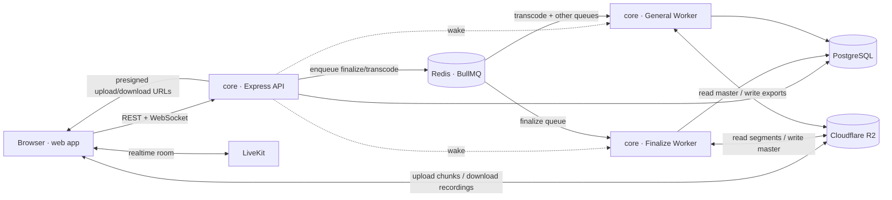

<div align="center">

<picture>
  <source media="(prefers-color-scheme: dark)" srcset="web/public/logo/logo-dark.png">
  <source media="(prefers-color-scheme: light)" srcset="web/public/logo/logo-light.png">
  
</picture>

### OPENSIDE

**Openside** is an open-source, self-hostable recording studio - capture high-quality meetings, podcasts, and screen recordings with multi-track, per-participant recording, then finalize them into clean, downloadable video.

[](LICENSE)
[](#getting-started-local-dev)
[](#contributing)


</div>

---

## Features

- **Studio-quality recording** - crisp video up to 4K with clear, high-quality audio
- **Multi-track, per-participant output** - each speaker on their own track, ready to edit
- **Screen recorder** - standalone screen + camera capture with pause/resume, codec fallback, and the camera composited in a single encode
- **Crash-safe uploads** - recordings stream up in chunks while you record, with live per-participant upload progress and automatic recovery of stuck takes
- **Projects & library** - every meeting and screen take in one place, with server-side search from the command menu
- **Comments & descriptions** - threaded comments with replies and edits on every recording, plus a description per project
- **Calendar & scheduling** - schedule meetings, send calendar invites, and see past recordings and screen takes on a calendar
- **Shareable recordings** - share any recording from your projects with a link
- **Export in any format** - download your recordings as MP4, WebM, MP3, or WAV
- **Cheaper than SaaS** - no per-seat fees, pay only for the infra you use
- **Use it for free** - connect your own LiveKit and storage in settings to unlock unlimited, watermark-free recording at no cost beyond your own usage
- **Open source & self-hostable** - MIT licensed, no vendor lock-in
- **Editor** - coming soon

---

## Architecture

Openside is **two apps**: a frontend (`web`) and a backend (`core`). `core` builds once and runs as several processes - the API and the media workers.



| Piece | Folder | What it does |
|-------|--------|--------------|
| **Web** | [`web/`](web) | React 19 + Vite SPA served from a Cloudflare Worker (`web/worker`), which also rewrites OG tags for meeting invite links. Recording UI, meeting rooms, screen recorder, dashboard, calendar, projects, share pages. |
| **API** | [`core/`](core) (`src/index.ts`) | Express + Socket.IO server: auth, spaces, recording sessions, LiveKit tokens, comments, search, billing, self-host keys, presigned downloads, an admin API at `/admin/v1`, and background maintenance (recovers stuck finalizes and abandoned sessions, meters usage, applies retention) on a timer. |
| **Finalize worker** | [`core/`](core) (`src/worker.ts --role=finalize`) | BullMQ consumer for the `finalize` queue: stitches uploaded chunks into each recording's master with `ffmpeg`, **off** the API. |
| **General worker** | [`core/`](core) (`src/worker.ts --role=general`) | BullMQ consumer for every other queue (on-demand transcodes today), so exports never delay a finalize. |

> All `core` processes share the Prisma schema, queue definitions, and services, so they're the **same build, different entrypoints** - no separate repo needed. Scale workers horizontally by running more instances.

### Worker roles

In production the worker runs as two services so finalization never waits
behind other media work:

| Role | Start command | Dev command | Env file | Queues |
|------|---------------|-------------|----------|--------|
| `finalize` | `pnpm worker:finalize` | `pnpm worker:finalize:dev` | `.env.production-finalize-worker` | `finalize` |
| `general` | `pnpm worker:general` | `pnpm worker:general:dev` | `.env.production-general-worker` | everything else (`transcode` today) |

The role comes from `--role=<role>` or `WORKER_ROLE`. With no role, one worker
consumes every queue (`pnpm worker` / `pnpm worker:dev`, handy for local dev).
New queues belong to the `general` role: register them in `QUEUE_ROLES`
(`src/lib/queue.ts`) and `QUEUE_DEFINITIONS` (`src/worker.ts`).

### Wake-on-demand worker

The workers can run in Railway Serverless mode instead of holding Redis
connections open all month. Set `WORKER_SERVERLESS=true` on each worker, set the
same `WORKER_WAKE_SECRET` on the API and workers, and set
`FINALIZE_WORKER_WAKE_URL` / `GENERAL_WORKER_WAKE_URL` on the API to each worker's
Railway private URL (`WORKER_WAKE_URL` is the fallback for a single all-queue
worker). After each enqueue the API wakes the worker that owns that queue; once
its queues are empty, the worker closes Redis and database connections so
Railway can put it to sleep. Enable **Serverless** on each Railway worker
service and redeploy for the platform setting to take effect.

The API stays **always on** (Serverless off): it runs maintenance on a timer, so
recovery, usage metering and retention keep going even when nobody is using the
app.

---

## Tech Stack

**Frontend** - React 19 · Vite · TypeScript · Tailwind · TanStack Query · React Router · Framer Motion · cmdk · LiveKit components · Socket.IO client · Clerk · Cloudflare Workers

**Backend (`core`)** - Node · Express 5 · TypeScript · Prisma 7 (PostgreSQL) · BullMQ + Redis · LiveKit Server SDK · `ffmpeg-static` · AWS S3 SDK (R2) · Socket.IO · Clerk · Resend · Polar (billing)

---

## Getting Started (Local Dev)

### Prerequisites

- **Node.js** 20+ and **pnpm** 10+ (`corepack enable`)
- **PostgreSQL** database
- **Redis** (required for the worker / media pipeline)
- A **LiveKit** project (cloud or self-hosted)
- A **Cloudflare R2** bucket (S3-compatible) for output storage
- A **Clerk** application for auth

### 1. Clone & install

```bash
git clone https://github.com/rinkitadhana/openside.git
cd openside

# Backend + worker
cd core && pnpm install

# Frontend
cd web && pnpm install
```

### 2. Configure environment

Copy the example env files and fill in your own values:

```bash
cp core/.env.example-api core/.env.local
cp web/.env.example  web/.env.local
```

Each key is documented in the example files (`core/.env.example-api`,
`-finalize-worker`, `-general-worker`). Every core process loads
the shared `.env.local` during local development. With `NODE_ENV=production`:

| Process | Env file |
|---------|----------|
| API | `.env.production-api` |
| Finalize worker | `.env.production-finalize-worker` |
| General worker | `.env.production-general-worker` |
| All-queue worker (no role) | `.env.production-worker` |

These production files are gitignored; hosted Railway services should keep their
values in Railway's Variables settings.

### 3. Set up the database

```bash
cd core
pnpm db:generate     # generate Prisma client
pnpm db:migrate      # apply migrations
```

### 4. Run everything

```bash
# Terminal 1 - API server
cd core && pnpm dev

# Terminal 2 - media worker (needs REDIS_URL)
cd core && pnpm worker:dev

# Terminal 3 - frontend
cd web && pnpm dev
```

Open http://localhost:3000 and you're in.

### 5. Deploy

- **Web** - `cd web && pnpm deploy` builds and deploys to Cloudflare Workers.
- **Core** - `cd core && pnpm build`, then run `pnpm start` (API), and `pnpm worker:finalize` + `pnpm worker:general` (workers).

---

## Contributing

Issues and PRs are always welcome. Before opening a PR, test your changes properly, and include screenshots plus the reasoning behind it so it's clear why the change is worth merging.

---

## License

Released under the [MIT License](LICENSE). Free to use, modify, and self-host.
